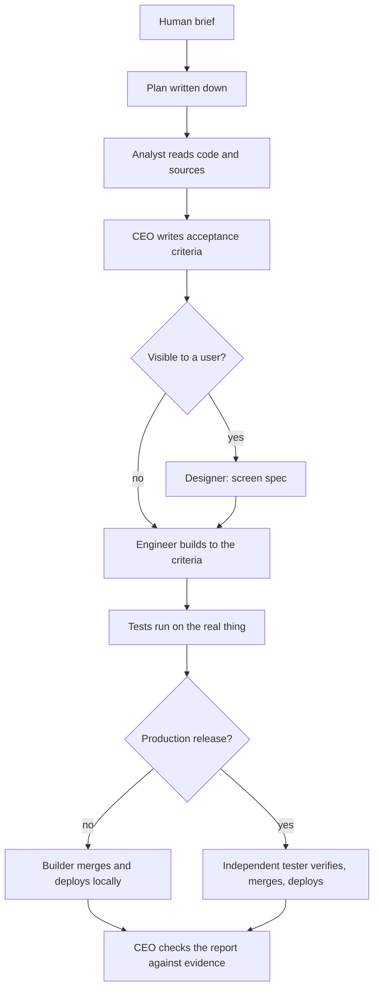
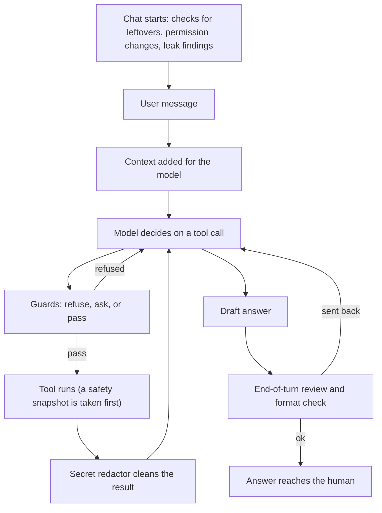
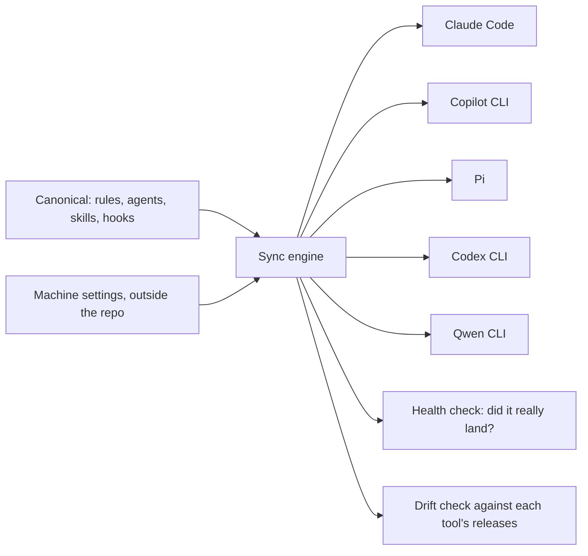

# Wrangling AI coding agents

This repository shows how I work with AI coding agents, and the system I built so they stay useful. It contains no real source files. Each folder has one README that explains the concepts, the high-level design, and the reasons behind the decisions.

The system is real and in daily use. Nothing here is a demo.

## The problem

Left alone, coding agents do predictable damage:

- **They drift.** Over a long session they forget the rules they were given, and do what is convenient.
- **They claim work is done that nobody ran.** "It should work" gets reported as "it works".
- **They leak secrets.** A key printed once into a session log is in the model provider's hands and in a transcript on disk.
- **They delete things.** A tidy-up request becomes a recursive delete over files that existed in one place only.
- **They widen their own permissions**, or write outside the project they were asked to work in.

Instruction files alone do not fix this. A rule in a prompt is followed while the model pays attention. So the system works at two levels: instructions that shape behavior, and code that enforces the rules that matter.

## The operating model

- **The main agent is the CEO.** It talks to the human, decides, and writes the acceptance criteria. On anything complex or dangerous it does not build; it briefs an agent and checks what comes back.
- **Role agents do the work.** An analyst reads, an engineer builds, a tester verifies and releases, with an architect, a designer and a security reviewer for specialist jobs. None of them decides anything; they hand back findings.
- **Gatekeeping.** Every complex or dangerous idea, the human's included, is challenged once in writing before it is acted on. The challenge must name a concrete cost, breakage or unchecked assumption, not a vague worry.
- **Evidence rules.** Every report is a claim. Claims are checked by running something, documents are treated as maps and not as truth, and nothing is called done until it was exercised the way a user would use it.
- **Hooks enforce what prompts cannot.** Small programs run around every tool call and turn, and refuse the dangerous ones.
- **Written plans.** Work with several steps is tracked in files, so a new chat can pick it up from the files alone.

## Order of work

The analyst comes before the criteria on purpose: criteria written from memory are guesses. The tester on a production release is never the agent that built the change.

## One turn, with the hooks around it

This chart follows one turn of a chat, from the moment it starts to the answer the human reads. At each step a hook runs: the guards that refuse or ask before a tool call, the safety snapshot and the secret redactor around it, and the review that can send a draft back. Each family is explained in [canonical/hooks/](canonical/hooks/README.md), and how the same guards run on a second tool is in [canonical/hooks/pi/](canonical/hooks/pi/README.md).

## One canonical, several tools

This chart shows how one master copy of the rules, agents, skills and hooks reaches every AI coding tool. A sync engine translates it into each tool's own format, then checks that it landed and that the notes about each tool still match that tool's latest release. Why there is one master copy is in [canonical/](canonical/README.md), and how the engine works is in [canonical/skills/syncness/](canonical/skills/syncness/README.md).

Nobody edits a deployed copy. One master is edited, and a script translates it for each tool.

## Map

| Folder | What it explains |
| --- | --- |
| [canonical/](canonical/README.md) | The single home for rules, agents, skills and hooks |
| [canonical/agents/](canonical/agents/README.md) | The role agents and why the work is split |
| [canonical/commands/](canonical/commands/README.md) | The rules-reload command |
| [canonical/hooks/](canonical/hooks/README.md) | Runtime guardrails around tool calls and turns |
| [canonical/hooks/pi/](canonical/hooks/pi/README.md) | Carrying the guards to a tool with a different hook model |
| [canonical/skills/](canonical/skills/README.md) | Task playbooks the agents load on demand |
| [canonical/skills/syncness/](canonical/skills/syncness/README.md) | The deploy engine |
