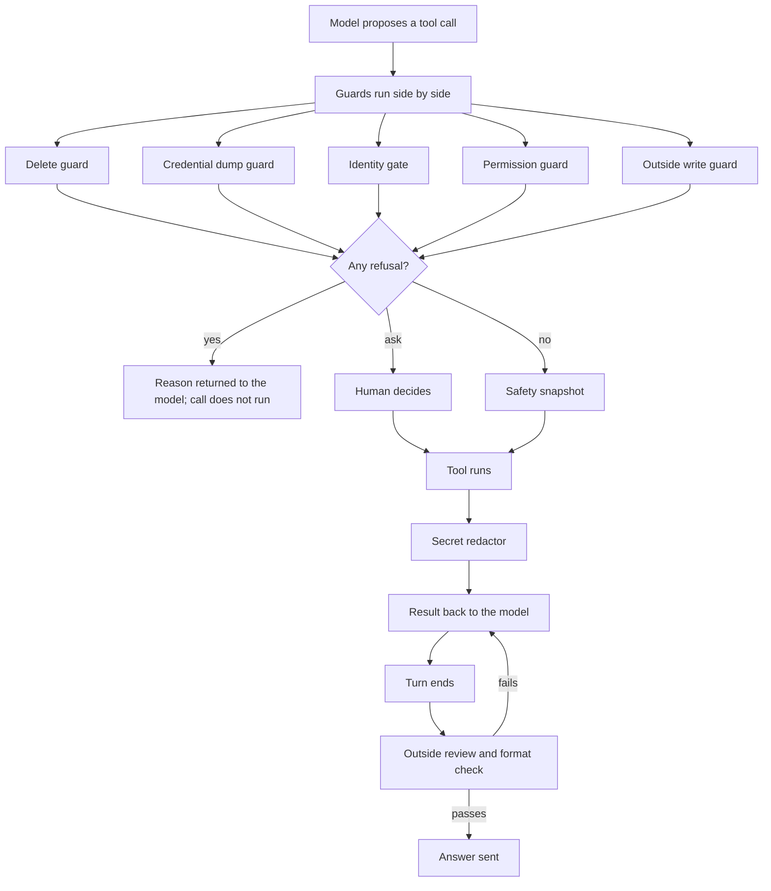

# Hooks

Hooks are small programs the AI tool runs by itself at fixed moments: when a chat starts, before a message reaches the model, before and after each tool call, and when a turn ends. They are runtime guardrails.

## Why hooks and not just instructions

A rule written in an instruction file is followed while the model is paying attention. A rule in a hook is checked on every matching call, however long the session has grown. Anything where one failure is costly (a leaked key, a destroyed file, a widened permission) is enforced in code. Instructions cover the behavior code cannot see.

The hook roster is declared once, in one file, in the format the primary tool expects. The sync engine builds the other tools' versions from it.

## Families by purpose

- **Dangerous-call guards.** Refuse or ask before a call can do harm that cannot be undone:
  - a delete chosen by a wildcard, substitution or variable;
  - a command that would dump a credentials file;
  - an outbound call carrying the owner's personal details;
  - a write that widens what agents may do;
  - a write outside the project, refused for a subagent and flagged for the main agent;
  - a private network name going to a third party.
- **Secret redactor.** Cleans every tool result before it is recorded, so a secret that was read once is not written into the session record and sent on. A commit that adds a known secret gets a warning.
- **Working-tree safety snapshots.** Before each write or shell command, the working tree is copied into a hidden reference. A bad edit can be reversed even when the work was never committed. A guard stops the agent from printing the snapshot's contents back out.
- **Outside reviewer.** At the end of a turn a second model reads the draft answer against the tool calls that turn actually made. If the draft says "tested" and no test ran, the draft goes back for rework.
- **Message-format check.** Verifies that the answer follows the agreed shape, such as numbered questions, and sends it back if not.
- **Chat-start checks.** On a new chat: a notice of any leak findings, a check for leftover scratch folders, and a warning when a permission file has changed since the last time it was seen.
- **Daily scanner.** A scheduled job reads the session records on disk for credentials that slipped through, and tells the owner. It reports where and what kind, and never prints the value.

## Design principles

- **Fail-open where blocking would lock the owner out; fail-closed where an error could hide harm.** The cheap, noisy checks never stop work when they themselves break. The few guards whose failure would let damage through block instead.
- **Settings live outside the repository.** What a guard enforces, and the log it writes, is in a per-machine file. The repository ships only a worked example. A cloned project cannot carry its own settings that disable a guard.
- **A project may only tighten.** A project can add restrictions to the machine's settings, never remove them. The merge is defined per setting, and unknown keys are ignored.
- **Guards do not leak what they guard.** A refusal message and a log line never contain the value that triggered them.
- **Every guard is tested two ways.** Once against values the test declares itself, so a settings change cannot break it, and once against the real files, checking only that they are valid.
- **The enforcement itself is protected.** Changes to the guards' own settings and records count as permission widenings and are asked about.
